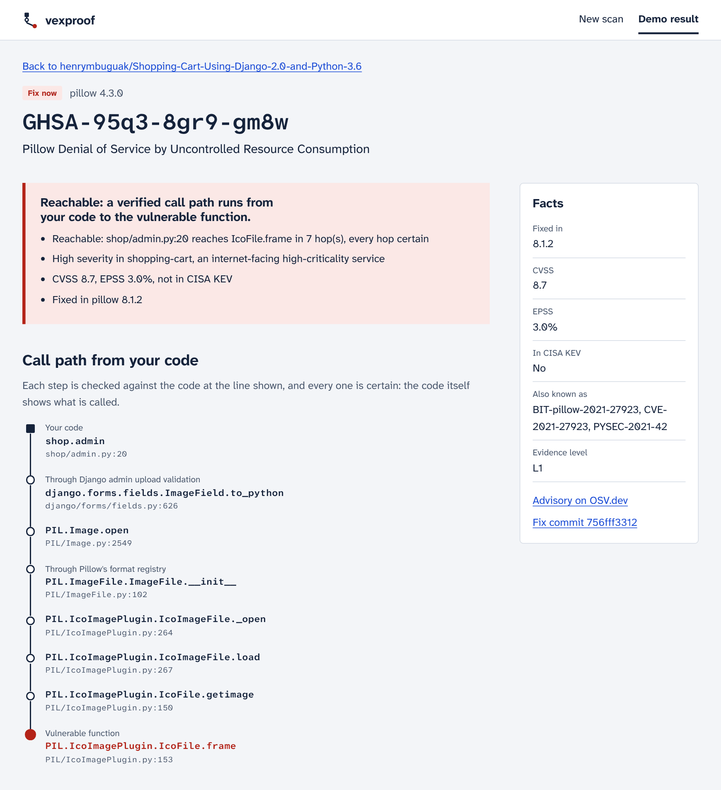
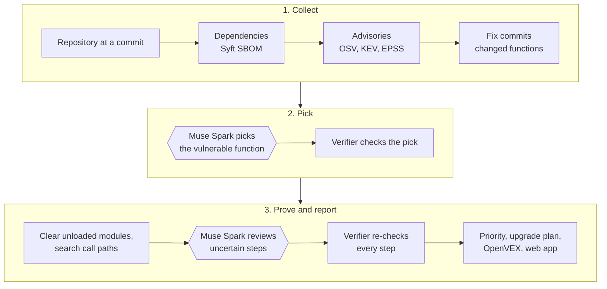

# vexproof

**Find out which dependency vulnerabilities your Python code can actually reach, and get the proof.**
*The AI proposes. The verifier proves.*

[](#built-during-the-meta-global-ai-developer-hackathon)
[](#5-configure-muse-spark)
[](https://github.com/henrymbuguak/vexproof/actions/workflows/ci.yml)

[](LICENSE)

> **Built during the Meta Global AI Developer Hackathon, October 26 – November 4, 2026.**
> Track: Indie Developer · Problem statement: Push the Frontier, with Muse Spark applied to
> vulnerability triage, a hard problem in software. The first commit dates from October 27, 2026, and the commit history
> records every step from there. Muse Spark, Meta's model, does the reading that static analysis
> cannot: it identifies the vulnerable function in each fix commit and judges call-path steps
> that the code alone cannot settle.

**[▶ Watch the 3-minute demo video](https://www.youtube.com/watch?v=degGH4wwkEk)**



*A real result: seven steps, each checked at the file and line shown, from the shop's admin
upload form to the function with the bug. Every step is certain, so no model judgment was
needed for this path.*

**See it in a minute, with no API key and no model:**

```bash
git clone https://github.com/henrymbuguak/vexproof.git && cd vexproof
uv sync --locked --all-groups
uv run vexproof serve      # open http://127.0.0.1:8000 and choose Demo result
```

---

## The problem

Dependency scanners check **versions**, not **code**.

A security advisory says, in effect: *"Pillow versions before 8.1.2 have a bug in the function
that reads ICO images."* A scanner checks only the first half of that sentence. If your project
installs Pillow 4.3.0, it raises an alert. It never checks the second half: **does your code
ever call the function that has the bug,** directly or through the libraries it uses? If it
does not, nobody can trigger the bug through your application, and the alert is noise.

Scanners cannot tell those two cases apart, so teams get long lists of alerts and no way to
know which ones matter. vexproof answers the second half of the question, and shows its
evidence.

For example, a scan of a small Django shop (one of the test projects) produces **94 alerts**.
vexproof settles 28 of them:

- **14 are reachable.** For each one, vexproof shows the **call path**: the chain of function
  calls, file by file and line by line, that leads from the shop's own code to the function
  with the bug. The ICO bug above is one of them: the shop's admin page accepts product image
  uploads, and Pillow reads each upload with whichever decoder matches the file, ICO included.
- **14 cannot affect the shop.** The shop never loads the part of the package that contains
  the bug, so nothing can call it.
- **66 stay open for review,** each with the reason vexproof could not decide. vexproof never
  marks an alert as harmless unless it can prove it.

### Why it matters

- **Real risks hide in the noise.** When every alert looks urgent, teams fix in arbitrary order
  or stop reading. The 14 reachable alerts deserve attention first.
- **Triage costs engineering time.** Deciding by hand whether a vulnerable function is reachable
  means reading the advisory, finding the fix commit, and tracing calls through the framework.
  That can take an expert hours for a single alert.
- **"Not affected" needs evidence.** [OpenVEX](https://github.com/openvex/spec) lets a project
  state which alerts do not apply to it, so that its users and their scanners can skip them.
  Such a statement is only worth something when others can check the reasoning behind it.

### Why it is hard

1. **Advisories use prose.** They describe the bug in words and rarely name the
   function at fault.
2. **Fix commits are broad.** One commit often changes several functions and sometimes fixes
   several advisories at once. Pillow's commit `756fff33` fixes ICO, ICNS and BLP bugs together.
3. **Python is dynamic.** Frameworks load code by name (`INSTALLED_APPS`, Pillow's format
   plugins), and method calls resolve at run time, so plain static analysis either misses paths
   or invents them.

## The approach

vexproof gives each job to whichever part does it best. **Deterministic analysis** handles
everything the code can prove. **Muse Spark** handles what needs reading and judgment.
**A verifier** checks every model answer against the code before vexproof uses it.



1. **Collect the alerts.** vexproof lists the project's dependencies with Syft, then looks up
   advisories in OSV, exploitation in CISA KEV, and exploit likelihood in FIRST EPSS.
2. **Find what each fix changed.** It fetches each fix commit with `git`, diffs it, maps the
   changed lines to functions, and confirms that those functions exist in the installed version.
3. **Pick the vulnerable function (Muse Spark).** The model reads the advisory and each
   candidate function's diff, picks the function the advisory is about, and quotes the advisory
   to justify the pick. The verifier rejects any name that is not a real candidate and any quote
   that is not in the advisory.
4. **Prove or clear.**
   - **Cleared** when your code never loads the module (the Python file) that holds the
     vulnerable function. vexproof works this out from your imports, from module names written
     as text in settings (such as Django's `INSTALLED_APPS`), and from hand-written rules for how
     frameworks load code. If anything loads code by a name vexproof cannot see, it refuses to
     clear.
   - **Reachable** when it finds a call path from your code to the vulnerable function. Most
     steps are **certain**: the code shows exactly which function gets called. Some are
     **uncertain**: a method is called on an object whose type Python only knows at run time.
     Muse Spark judges whether each uncertain step is plausible, and the verifier re-checks every
     step against the code.
   - **Open** when neither applies. vexproof lists open alerts with a reason and never drops
     them silently.
5. **Decide what to fix first.** vexproof ranks alerts by evidence, exploit signals and your
   service profile, works out the smallest upgrade for each package, and exports OpenVEX and a
   self-contained HTML report.

### Principles

- **Never run the target's code.** vexproof reads package files as data and fetches fix commits
  with `git`. It installs and executes nothing from the project it scans
  ([ADR 0001](docs/adr/0001-never-execute-target-code.md)).
- **The model proposes; the verifier proves.** No model answer changes a verdict until it passes
  deterministic checks ([ADR 0007](docs/adr/0007-model-proposes-verifier-proves.md)).
- **Only evidence clears an alert.** Failing to find a call path never clears anything.
- **Reproducible runs.** vexproof records every model answer, keyed by model, prompt version and
  inputs, so a re-run is free and returns the same result.

## Results

I checked vexproof against reality. I ran each test project under a scripted workload
(browsing, cart, checkout, admin login, and image uploads) and recorded every module that loaded
and every function that ran. Then I compared the scan with that record.

| Measure | Django shop | [justdjango/django-ecommerce](https://github.com/justdjango/django-ecommerce) | Together |
| --- | --- | --- | --- |
| Alerts from version matching | 94 | 137 | 231 |
| Cleared with evidence | 14 | 16 | 30 |
| Reachable, with a verified call path | 14 | 15 | 29 |
| **Clears contradicted by the running project** | **0 of 14** | **0 of 16** | **0 of 30** |
| **Loaded modules missing from the analysis** | **0 of 470** | **0 of 776** | **0 of 1,246** |
| Reachable paths whose vulnerable function ran | 13 of 14 | 12 of 15 | 25 of 29 |
| Muse Spark picks matching hand-checked answers | 13 of 13 | 9 of 9 | 22 of 22 |
| Estimated model cost of a scan without recorded answers | $0.95 | $3.61 | |

The cost row is an estimate, not a bill. vexproof counts every input and output token the scan
sends to Muse Spark, including answers replayed from its recordings, and prices them at
$1.25 per million input tokens and $4.25 per million output tokens. Those are rates I set in
`VEXPROOF_PRICE_INPUT_PER_M` and `VEXPROOF_PRICE_OUTPUT_PER_M` to approximate a per-token API.
My runs went through Ollama's cloud service, which does not bill per token, so the row shows
what the same tokens would cost on an API at those rates. The shop scan used about 228,000 input
and 156,000 output tokens; multiply by your provider's prices for your own estimate.

Full reports: [eval/results/shop-1aa90f6.md](eval/results/shop-1aa90f6.md) and
[eval/results/justdjango-260952e.md](eval/results/justdjango-260952e.md). The Django shop is
[henrymbuguak/Shopping-Cart-Using-Django-2.0-and-Python-3.6](https://github.com/henrymbuguak/Shopping-Cart-Using-Django-2.0-and-Python-3.6)
at commit `1aa90f6`.

### One alert, explained

GHSA-95q3-8gr9-gm8w is a denial-of-service bug in Pillow's ICO decoder. The fix commit changes
two functions. Muse Spark picked `IcoFile.frame` and quoted the advisory. vexproof then found
this path from the shop's admin code, with every step certain (output abridged):

```console
$ uv run vexproof show examples/demo/findings.json GHSA-95q3-8gr9-gm8w
picked: PIL.IcoImagePlugin.IcoFile.frame  (muse-spark-open:cloud / symbol_pick.v1)
  advisory says: "reported size of a contained image is not properly checked for an ICO container"
call path from your code (all hops certain)
    shop.admin  shop/admin.py:20
    django.forms.fields.ImageField.to_python  django/forms/fields.py:626 via django_admin_upload
    PIL.Image.open  PIL/Image.py:2549 via call
    PIL.ImageFile.ImageFile.__init__  PIL/ImageFile.py:102 via pillow_open_registry
    PIL.IcoImagePlugin.IcoImageFile._open  PIL/IcoImagePlugin.py:264 via call
    PIL.IcoImagePlugin.IcoImageFile.load  PIL/IcoImagePlugin.py:267 via call
    PIL.IcoImagePlugin.IcoFile.getimage  PIL/IcoImagePlugin.py:150 via call
    PIL.IcoImagePlugin.IcoFile.frame  PIL/IcoImagePlugin.py:153 via call
  check passed: symbols_in_shortlist
  check passed: symbols_in_installed_code
  check passed: quote_found_in_advisory
  check passed: call_path_verified
```

When the workload uploaded an ICO image through the admin, `IcoFile.frame` ran, which confirms
the path.

### What Muse Spark adds

To measure the model's contribution, compare the shop scan with what the same pipeline would
do without it: follow **every** function the fix changed, and leave every uncertain step
unreviewed. (`--no-model` goes further: it skips call-path search entirely and proves nothing
reachable, which says more about the design than about the model.) I counted these numbers
from [examples/demo/findings.json](examples/demo/findings.json).

| In the shop scan, Muse Spark… | Alerts | Without the model |
| --- | --- | --- |
| Reviewed an uncertain step, so vexproof could prove the alert reachable | 3 | The alerts stay open for review |
| Picked the one function the advisory is about, out of several the fix changed | 11 | Call paths lead to any changed function, including ones the advisory does not mention |
| Found that **none** of the changed functions matches the advisory | 4 | vexproof follows an unrelated function and may report a path that has nothing to do with the bug |
| Changed a clear | 0 | Clears rest on module loading alone |

Three cases show each job:

- **Proving an open alert reachable: GHSA-5hg3-6c2f-f3wr** (Django open redirect, EPSS 25%, priority
  *fix now*). The path runs from `MIDDLEWARE` in `myshop/settings.py` into `CommonMiddleware`.
  One step goes through Django's middleware dispatch, where the object's type is only known at
  run time. Muse Spark judged that step plausible, explaining that Django calls every class
  listed in `MIDDLEWARE`. The verifier then re-checked every step. Without the model, this alert
  stays in *review*.
- **Choosing among changed functions: GHSA-95q3-8gr9-gm8w.** Pillow's commit `756fff33` fixes ICO, ICNS
  and BLP bugs at once. Muse Spark picked the ICO function and quoted the advisory to justify
  the pick.
- **Rejecting all of them: GHSA-f4w8-cv6p-x6r5.** This BLP advisory points at the same commit.
  Pillow 4.3.0 has no BLP decoder, so the only changed functions it contains are the ICO and
  ICNS ones. Muse Spark answered that no candidate matches. Without it, vexproof would follow `IcoFile.frame` and could report the ICO path above
  as evidence for a BLP bug.

### What a team gets

- **A short list instead of a long one:** *fix now*, *fix soon*, *review* and *not affected*,
  each with the reason.
- **An upgrade plan:** for the shop, Pillow ≥ 13.0.0 and Django ≥ 4.2.26 close every reachable
  alert.
- **OpenVEX** that other tools can consume: `not_affected` with the evidence for cleared alerts,
  `affected` with the call path and upgrade for reachable ones, and `under_investigation` for
  open ones.
- **A web app** for people who do not use a terminal. It meets WCAG 2.2 AA (checked with
  axe-core in light and dark themes, on desktop and phone widths), works without JavaScript,
  and allows no inline or third-party code.

## Getting started

### Prerequisites

| Tool | Needed for | Install |
| --- | --- | --- |
| Git | Cloning, fetching fix commits | [git-scm.com](https://git-scm.com/downloads) |
| [uv](https://docs.astral.sh/uv/) | Python 3.12 and all dependencies | `curl -LsSf https://astral.sh/uv/install.sh \| sh` |
| [Syft](https://github.com/anchore/syft) | Listing a project's dependencies (step 6 only) | `brew install syft`, or `curl -sSfL https://raw.githubusercontent.com/anchore/syft/main/install.sh \| sh -s -- -b /usr/local/bin` |
| [Ollama](https://ollama.com) | Muse Spark Open (steps 5 and 6 only) | [ollama.com/download](https://ollama.com/download) |
| Docker (optional) | Running everything in one container | [docs.docker.com](https://docs.docker.com/get-docker/) |

uv downloads Python 3.12 by itself if your machine does not have it. Step 3 uses `make`, which
macOS and Linux include. Steps 1 to 4 need no model, no API key and no Syft.

### 1. Clone the repository

```bash
git clone https://github.com/henrymbuguak/vexproof.git
cd vexproof
```

### 2. Install the dependencies

```bash
uv sync --locked --all-groups
```

`--locked` installs the exact versions in `uv.lock`, and `--all-groups` includes the web app and
the development tools.

### 3. Run the test suite

```bash
make check
```

This runs Ruff, mypy in strict mode, and the offline test suite with a coverage gate. Expect
`355 passed, 2 deselected` and coverage above 85%. The tests make no network or model calls.

### 4. Explore the demo result

The repository includes the shop's real scan in `examples/demo/findings.json`, so you can see
every feature before configuring anything.

```bash
uv run vexproof serve
```

Open <http://127.0.0.1:8000> and choose **Demo result**. From there, open an alert such as
GHSA-95q3-8gr9-gm8w to see its call path, and choose **How this was checked** to see the evaluation.
Press `Ctrl+C` to stop the server.

The same result works from the command line:

```bash
# Explain one alert: the model's pick, the verifier's checks and the call path
uv run vexproof show examples/demo/findings.json GHSA-95q3-8gr9-gm8w

# What to fix first, the upgrade plan, and the HTML and OpenVEX exports
uv run vexproof report examples/demo/findings.json --profile examples/shop_profile.yaml \
    --html report.html --openvex vex.json

# Compare the scan with the recorded run of the shop
uv run vexproof eval examples/demo/findings.json --observed eval/observed/shop-1aa90f6.json \
    --gold eval/gold/symbols.yaml
```

### 5. Configure Muse Spark

vexproof uses **Muse Spark Open** (`muse-spark-open:cloud`), Meta's open-weight Muse Spark,
served through [Ollama](https://ollama.com). It needs no API key. I produced every result in
this README this way.

1. Install Ollama, sign in (Muse Spark Open runs on Ollama's cloud), and fetch the model:

   ```bash
   ollama signin
   ollama pull muse-spark-open:cloud
   ollama serve        # skip this if the Ollama app is already running
   ```

2. Copy the example settings. They already point at Muse Spark Open, so you do not need to
   edit anything. git ignores `.env`, so nothing in it leaves your machine.

   ```bash
   cp .env.example .env
   ```

3. Check that the model works:

   ```bash
   uv run vexproof check-model                                # connection and structured output
   uv run vexproof check-model examples/demo/findings.json    # plus the gold test
   ```

   `check-model` prints GO only when the model gets at least 75% of the gold cases right and
   invents no function names. If Ollama is not running, it says so and prints NO-GO.

vexproof talks to the model through an OpenAI-compatible client, so `.env.example` also holds a
commented-out block for the hosted Meta Model API. **I have not run vexproof against the Meta
Model API:** I could not complete the account's billing setup during the event, so treat that
path as untested.

### 6. Scan a project

From the web app: run `uv run vexproof serve`, paste a public GitHub repository URL and a
commit, choose the service's exposure and criticality, and follow the scan stage by stage.

From the command line, this scans the Django shop from the results above:

```bash
uv run vexproof scan https://github.com/henrymbuguak/Shopping-Cart-Using-Django-2.0-and-Python-3.6 \
    --commit 1aa90f67f4559a36d8049d8a2d3fe622791ee95c \
    --profile examples/shop_profile.yaml \
    --json findings.json --html report.html --openvex vex.json
```

The first scan downloads packages and fix commits and asks the model about each alert that has
a fix commit to read. It takes several minutes and needs Syft and Ollama. vexproof caches all
of it in `.vexproof-cache/`, so a second scan runs in seconds and makes no new model calls. To
skip the model entirely, add `--no-model`.

Other ways to scan:

| Command | Use it to |
| --- | --- |
| `vexproof scan path/to/project` | Scan a local directory |
| `vexproof scan path/to/project --sbom sbom.json` | Use an existing CycloneDX or SPDX SBOM instead of Syft |
| `vexproof scan ... --no-model` | Run only the deterministic analysis |
| `vexproof scan ... --no-trace` | Pick functions with the model but skip call-path search |

### 7. Run it with Docker (optional)

```bash
docker compose up --build
```

Then open <http://127.0.0.1:8000>. The image contains Python, uv and Syft, each pinned and
checked against its published SHA-256, and runs as a non-root user. Compose reads your `.env`
when the container starts and never copies it into the image. If your `.env` points at Ollama
on `localhost`, the container reaches it on your computer automatically.

## How vexproof decides

### Evidence levels

| Level | Meaning | How vexproof decides |
| --- | --- | --- |
| L0 | Your code never imports the package: **cleared** | vexproof follows every import from your code, directly and through other packages, including module names in settings such as `INSTALLED_APPS`. It applies cautious rules for plugins and imports built at run time |
| L1 | The functions the fix changed exist in your installed version | vexproof fetches the fix commit with git, diffs it, maps the changes to functions, and checks them against the installed package |
| L2 | Only the changed module is known | Module-level changes, or changed functions that your version does not contain |
| L3 | Needs review | No fix commit, a fix in native code, or code missing from the package |

### Checks on every model answer

| Check | Rejects the answer when |
| --- | --- |
| `symbols_in_shortlist` | A picked name is not one of the candidate functions (an invented function) |
| `symbols_in_installed_code` | A picked function does not exist in your installed version |
| `quote_found_in_advisory` | The quote is not in the advisory text, or is too short to mean anything |
| `call_path_verified` | A step in a call path does not hold in the code |

A rejected answer changes nothing; vexproof records it as a note on the alert.

A **certain** step calls something whose identity the code shows: a function through its
imports, or a method on an object whose class is known (`self`, `super()`,
`form = PasswordResetForm()`). An **uncertain** step calls a method on an object of unknown type.
Muse Spark reviews only uncertain steps. vexproof carries types along a path, so once a view
builds a `CartAddProductForm`, a later `self.clean()` cannot be `AuthenticationForm.clean`.

### Priority

Evidence decides *whether* an alert matters; exploit signals and your service profile decide
*how soon*.

| Priority | Rule |
| --- | --- |
| **fix now** | Reachable, and listed in CISA KEV, or EPSS ≥ 10%, or critical severity, or high severity in an internet-facing service whose criticality is not low |
| **fix soon** | Reachable otherwise |
| **review** | Open; known-exploited first, then by severity and EPSS |
| **not affected** | Cleared with evidence |

The service profile (see [examples/service_profile.yaml](examples/service_profile.yaml)) only
moves alerts between *fix now* and *fix soon*. It never changes a verdict
([ADR 0010](docs/adr/0010-priority-never-changes-verdicts.md)).

## Evaluation method

The scanner never runs target code, so the check is a separate tool
([ADR 0011](docs/adr/0011-evaluate-by-running-the-project.md)).
`eval/dynamic/observe.py` runs a project with its exact pinned packages in a throwaway
environment, drives it with a workload script, and records every loaded module and every
function call. `vexproof eval` compares a scan with that record:

| Check | Fails the evaluation |
| --- | --- |
| A cleared alert's module loaded at run time | Yes |
| A module loaded at run time is missing from the modules the scan said could load | Yes |
| A reachable alert's vulnerable function ran | No: it confirms the path |
| An open alert's picked function ran | No: it marks a lead that path search missed |
| Function picks against hand-checked answers, and model cost | No: reported |

To rebuild the observations from scratch, run `eval/dynamic/observe_shop.sh` and
`eval/dynamic/observe_justdjango.sh`.

The hand-checked answers live in [eval/gold/symbols.yaml](eval/gold/symbols.yaml): 22 cases,
each with the reason for its answer. The set is small, so read 22 of 22 as "small,
hand-checked and reproducible", not as a general accuracy rate.

I added one label after the model disagreed with the answer key, and that change deserves an
explanation. On October 29, in the commit that created the answer key (`de11066`), I labelled
GHSA-f4w8-cv6p-x6r5 (a bug in
Pillow's BLP decoder) from the shop, which installs Pillow 4.3.0. The answer there is "none":
the shared fix commit `756fff33` changes BLP, ICO and ICNS code, but Pillow 4.3.0 has no BLP
decoder, so no installed function can be the bug. That label is unchanged.

The justdjango project installs Pillow 6.2.2. There, Muse Spark picked
`BLP1Decoder._decode_jpeg_stream`, and the evaluation marked the pick wrong against the old
"none" label. Before changing anything, I checked the facts independently of the model:

- The Pillow 4.3.0 wheel on PyPI contains no `BlpImagePlugin` module; the 6.2.2 wheel does.
- Commit `756fff33` adds the missing size check to `BLP1Decoder._decode_jpeg_stream`, the
  function the advisory describes, and that function exists, unpatched, in 6.2.2.

The right answer depends on the installed version, so each label now names the versions it
holds for: "none" for 4.3.0, `BLP1Decoder._decode_jpeg_stream` for 6.2.2. The change sits in its
own commit, `eed7e29` ("fix(eval): gold answers name the versions they hold for"), so anyone can
review it. Muse Spark's answer on the shop ("none") matched the original label throughout.

The evaluation found real gaps, and I fixed each one with a test. For example, Django loads
migration files such as `0001_initial.py` by name, and the scan had missed them. A scan of a
Flask project exposed a wrong clear for a package whose import name differs from its
distribution name, and vexproof now refuses to clear in that case.

## Limitations

- **Python only**, for packages from PyPI. vexproof scans local directories and public GitHub
  repositories.
- **Bugs in native code stay open.** When a fix changes only C code or bundled libraries,
  vexproof has no Python function to trace and marks the alert for review.
- **vexproof knows frameworks through hand-written rules.** Rules exist for Django, Pillow,
  django-allauth and the Django debug toolbar. When vexproof meets code loaded by a name it
  cannot see, it leaves the alert open rather than clearing it, so other frameworks mean more
  open alerts. I have evaluated two Django projects against the running code; other frameworks
  have no such check yet.
- **Some leads remain.** Across both projects, 9 open alerts had a picked function that ran
  under the workload: paths the search has not found yet. Four reachable paths were not
  exercised by the workloads, so the evaluation could not confirm them.
- **Paths that start in `manage.py`** are reachable only by an operator, and vexproof does not
  label them that way yet.
- **The hosted Meta Model API is untested.** All results use Muse Spark Open through Ollama.

## Project layout

| Path | Contents |
| --- | --- |
| `src/vexproof/ingest/`, `sources/` | SBOMs, repositories at a commit, package files |
| `src/vexproof/intel/` | OSV, CISA KEV and EPSS clients |
| `src/vexproof/static/` | Which modules your code can load, the code index, framework rules |
| `src/vexproof/symbols/`, `llm/`, `prompts/` | Function picks with Muse Spark, the verifier, recorded model answers, versioned prompts |
| `src/vexproof/evidence/` | Clears and call-path search, review and verification |
| `src/vexproof/report/` | Priority, upgrade plan, OpenVEX and HTML |
| `src/vexproof/web/` | The web app |
| `src/vexproof/evaluate/`, `eval/` | The evaluation: workloads, observations, gold answers, results |
| `docs/adr/` | Twelve architecture decision records |
| `tests/` | 355 offline tests on synthetic fixtures |

## Development

| Command | What it does |
| --- | --- |
| `make check` | Lint, format check, strict type check, and offline tests with a coverage gate (what CI runs) |
| `make fmt` | Format the code and apply safe lint fixes |
| `make audit` | Audit vexproof's own locked dependencies for known vulnerabilities |
| `make smoke` | Run live tests against OSV, KEV and EPSS (needs network) |

Pre-commit hooks run Ruff, mypy, gitleaks and file checks before each commit. Install them once
with `uv run pre-commit install`.

## Built during the Meta Global AI Developer Hackathon

### What I built and what I used

**Built during the event (October 26 – November 4, 2026):** everything in this repository. That
covers the scanner, the verifier, the prompts, the web app, the Docker image, the evaluation
tools and workloads, the hand-checked answers, the recorded scans and these docs. The commit
history dates every step, starting on October 27.

**Test subjects, not part of the submission.** The evaluation scans and runs two existing
projects. Neither is copied into this repository; the scripts in `eval/dynamic/` clone each one
at a pinned commit into a throwaway directory.

- **The Django shop**,
  [henrymbuguak/Shopping-Cart-Using-Django-2.0-and-Python-3.6](https://github.com/henrymbuguak/Shopping-Cart-Using-Django-2.0-and-Python-3.6),
  is a tutorial project I published in December 2017 and January 2018. I chose it because its
  old, pinned dependencies (Django 2.0, Pillow 4.3.0) carry many known advisories. Nothing in it
  changed for the hackathon.
- **[justdjango/django-ecommerce](https://github.com/justdjango/django-ecommerce)** is a
  third-party project under GPL-3.0. vexproof only scans it, and the evaluation runs it in a
  throwaway environment.

**Used, not built:**

- **Meta models:** Muse Spark Open (`muse-spark-open:cloud`), served by Ollama, picks the
  vulnerable function for each alert and reviews uncertain call-path steps. Every result in this
  repository comes from Muse Spark Open. I did not use the hosted Meta Model API: I could not
  complete its billing setup during the event. The OpenAI-compatible client can target it, but
  that path is untested. The prompts are my own, versioned in `src/vexproof/prompts/`.
- **Third-party libraries:** pydantic, pydantic-settings, httpx, stamina, packaging, cvss,
  PyYAML, typer, rich, structlog, unidiff and openai; FastAPI, Jinja2 and uvicorn for the web
  app. `pyproject.toml` and `uv.lock` list exact versions.
- **External tools:** [Syft](https://github.com/anchore/syft) for SBOMs;
  [Ollama](https://ollama.com) to serve Meta's open-weight models; uv-managed CPython 3.8 to run
  the test projects during evaluation; Ubuntu 24.04 as the Docker base image; axe-core and
  Playwright to test the web app's accessibility.
- **Data sources:** [OSV.dev](https://osv.dev) (including GitHub Security Advisories and the
  PyPA advisory database), [CISA KEV](https://www.cisa.gov/known-exploited-vulnerabilities-catalog),
  [FIRST EPSS](https://www.first.org/epss/), [PyPI](https://pypi.org) (package files, verified by
  SHA-256), and fix commits from the upstream projects' public GitHub repositories.
- **Standards:** [OpenVEX v0.2.0](https://github.com/openvex/spec) and
  [package URLs](https://github.com/package-url/purl-spec).
- **Fonts:** [Atkinson Hyperlegible Next and Mono](https://www.brailleinstitute.org/freefont/)
  by the Braille Institute, under the SIL Open Font License.

## Related work

Endor Labs, Snyk and Semgrep offer commercial reachability analysis.
[Vexcalibur](https://pypi.org/project/vexcalibur/) generates VEX documents from SBOMs and OSV
findings. vexproof adds a model that identifies the vulnerable function from human-written
advisories and fix commits, a verifier that checks every model answer, and an evaluation
against the running project. Every OpenVEX statement it produces carries its evidence.

## License

MIT. See [LICENSE](LICENSE).
